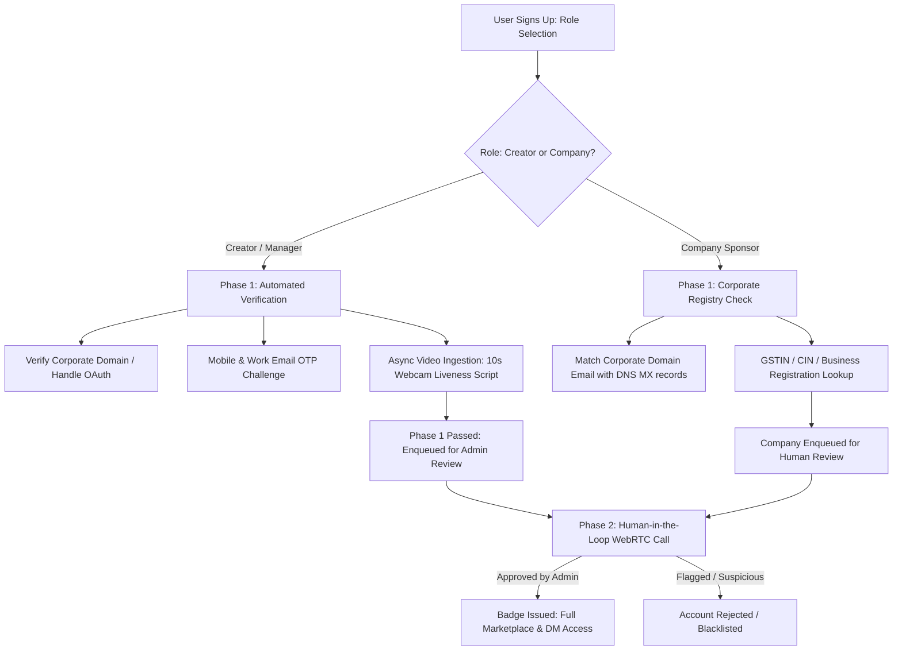
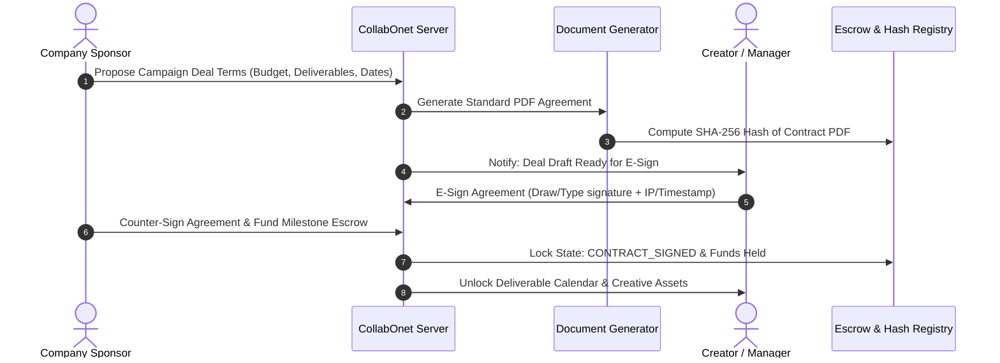

# CollabOnet — Engineering Specification & Technical Implementation Blueprint

> **System**: Connecting & Management Platform for Creators, Agencies/Managers, and Brand Sponsors  
> **Source Reference**: [Notion Specification](https://app.notion.com/p/Connecting-management-tool-for-Social-media-agencies-and-creators-408e3efc57dc8018b80df5d37f939db0)  
> **Status**: Ready for Implementation  
> **Target Platforms**: Responsive Web (Next.js 15) & Mobile (React Native / Expo)

---

## 1. Executive Summary & System Goals

The creator-sponsor marketplace is rife with intermediary corruption, middleman fee skim scams, identity impersonation, and payment defaults. **CollabOnet** solves this with a cryptographically verified, human-in-the-loop validated ecosystem where verified Brand Sponsors, Talent Managers, and Creators conduct transparent ad campaign negotiations, sign legally binding digital agreements, track deliverable milestones, and hold fraudulent actors accountable.

### Key Architectural Pillars
1. **Zero-Trust Identity**: 2-Phase verification (Automated Proof-of-Handle + Admin Video KYC).
2. **Dual-Access RBAC**: Distinct privacy boundaries for Talent Managers vs. Independent Content Creators.
3. **Escrow & E-Sign Engine**: Formal deal generation with cryptographic document hashing and milestone unlock.
4. **Transparent Governance**: Verified "Hall of Shame" public audit log backed by evidentiary dispute resolution.

---

## 2. High-Level Architecture & Tech Stack

```
                              ┌──────────────────────────────────────────┐
                              │             Client Layer                 │
                              │  - Web: Next.js 15 (App Router, React 19)│
                              │  - Mobile: React Native (Expo SDK 52)    │
                              │  - State: TanStack Query + Zustand       │
                              └────────────────────┬─────────────────────┘
                                                   │ HTTPS / WSS
                                                   ▼
                              ┌──────────────────────────────────────────┐
                              │         API & Application Layer          │
                              │  - Node.js / Next.js Server Actions      │
                              │  - Real-time: Supabase Realtime / WS     │
                              │  - Video KYC: LiveKit / Daily.co WebRTC  │
                              └────────────────────┬─────────────────────┘
                                                   │
                ┌──────────────────────────────────┼──────────────────────────────────┐
                │                                  │                                  │
                ▼                                  ▼                                  ▼
┌───────────────────────────────┐  ┌───────────────────────────────┐  ┌───────────────────────────────┐
│     Persistence & Cache       │  │      Media & Documents        │  │     External Integrations     │
│ - PostgreSQL (via Supabase)   │  │ - Cloudflare R2 / S3 (Storage)│  │ - Social APIs (IG, YT, X)     │
│ - Prisma ORM / Drizzle        │  │ - PDF-Lib / @react-pdf/render │  │ - SendGrid / Twilio (OTP)     │
│ - Redis (Upstash) for Queues  │  │ - SHA-256 Document Hasher     │  │ - Stripe Connect (Escrow)     │
└───────────────────────────────┘  └───────────────────────────────┘  └───────────────────────────────┘
```

### Recommended Production Stack
- **Framework**: Next.js 15 with TypeScript & Tailwind CSS.
- **Backend / Database**: Supabase (PostgreSQL with Row Level Security + Auth + Storage).
- **ORM**: Prisma for schema generation, strict type safety, and database migrations.
- **Real-Time Communication**: Supabase Realtime Channels or Socket.io.
- **Storage**: AWS S3 or Cloudflare R2 (presigned URL uploads for KYC videos and contracts).
- **Video Calls (Human KYC)**: Daily.co or LiveKit Cloud (lightweight WebRTC embedding).
- **Job Queues**: Inngest or BullMQ on Redis for background email/SMS reminders and post scraping.

---

## 3. Database Schema Design (Prisma Data Model)

```prisma
datasource db {
  provider = "postgresql"
  url      = env("DATABASE_URL")
}

generator client {
  provider = "prisma-client-js"
}

enum UserRole {
  CREATOR
  MANAGER
  COMPANY_SPONSOR
  ADMIN
}

enum VerificationStatus {
  UNVERIFIED
  PHASE_1_PENDING
  PHASE_1_PASSED
  PHASE_2_SCHEDULED
  VERIFIED
  REJECTED
  SUSPENDED
}

enum CampaignStatus {
  DRAFT
  OPEN
  IN_NEGOTIATION
  CONTRACT_SIGNED
  IN_PROGRESS
  DELIVERED
  COMPLETED
  DISPUTED
}

enum DealSignStatus {
  DRAFT
  AWAITING_CREATOR
  AWAITING_SPONSOR
  COMPLETED
  VOIDED
}

model User {
  id              String             @id @default(uuid())
  email           String             @unique
  phone           String?            @unique
  passwordHash    String?
  role            UserRole
  verification    VerificationStatus @default(UNVERIFIED)
  createdAt       DateTime           @default(now())
  updatedAt       DateTime           @updatedAt

  // Relationships
  creatorProfile  CreatorProfile?
  companyProfile  CompanyProfile?
  managedBy       AgencyRelationship[] @relation("CreatorToManager")
  managers        AgencyRelationship[] @relation("ManagerToCreator")
  sentMessages    Message[]            @relation("SentMessages")
  contracts       Contract[]           @relation("UserContracts")
  auditReports    DisputeReport[]
}

model AgencyRelationship {
  id        String   @id @default(uuid())
  managerId String
  creatorId String
  manager   User     @relation("ManagerToCreator", fields: [managerId], references: [id])
  creator   User     @relation("CreatorToManager", fields: [creatorId], references: [id])
  createdAt DateTime @default(now())

  @@unique([managerId, creatorId])
}

model CreatorProfile {
  id            String   @id @default(uuid())
  userId        String   @unique
  user          User     @relation(fields: [userId], references: [id], onDelete: Cascade)
  handle        String   @unique
  displayName   String
  bio           String?
  pitch         String?
  niche         String[] // e.g. ["Tech", "Gaming", "Fitness"]
  primaryPlatform String // "YOUTUBE", "INSTAGRAM", "TWITTER", "TIKTOK"
  platformUrl   String
  baseRate      Decimal  @db.Decimal(10, 2)
  reachStats    Json?    // { followers: 150000, avgViews: 25000, engagementRate: 4.2 }
  verifiedBadge Boolean  @default(false)
  kycVideoUrl   String?
  updatedAt     DateTime @updatedAt
}

model CompanyProfile {
  id              String   @id @default(uuid())
  userId          String   @unique
  user            User     @relation(fields: [userId], references: [id], onDelete: Cascade)
  companyName     String
  registrationNo  String?  // CIN / GSTIN / Tax ID
  websiteUrl      String
  officialDomain  String   // e.g. "nike.com" for email verification
  industry        String
  verifiedBadge   Boolean  @default(false)
  campaigns       Campaign[]
}

model Campaign {
  id          String         @id @default(uuid())
  companyId   String
  company     CompanyProfile @relation(fields: [companyId], references: [id])
  title       String
  description String
  budget      Decimal        @db.Decimal(10, 2)
  niche       String[]
  platforms   String[]
  deadline    DateTime
  status      CampaignStatus @default(OPEN)
  createdAt   DateTime       @default(now())

  contracts   Contract[]
  deliverables Deliverable[]
}

model Contract {
  id              String         @id @default(uuid())
  campaignId      String
  campaign        Campaign       @relation(fields: [campaignId], references: [id])
  creatorId       String
  creator         User           @relation("UserContracts", fields: [creatorId], references: [id])
  dealTermsJson   Json
  documentPdfUrl  String
  documentHash    String         // SHA-256 checksum of generated agreement
  status          DealSignStatus @default(DRAFT)
  creatorSignDate DateTime?
  sponsorSignDate DateTime?
  payoutAmount    Decimal        @db.Decimal(10, 2)
  createdAt       DateTime       @default(now())
}

model Deliverable {
  id          String   @id @default(uuid())
  campaignId  String
  campaign    Campaign @relation(fields: [campaignId], references: [id])
  title       String   // e.g. "Draft Reel #1", "Final YouTube Integration"
  dueDate     DateTime
  liveUrl     String?  // URL of the published post
  isSubmitted Boolean  @default(false)
  isApproved  Boolean  @default(false)
}

model Message {
  id             String   @id @default(uuid())
  conversationId String
  senderId       String
  sender         User     @relation("SentMessages", fields: [senderId], references: [id])
  content        String
  attachments    String[]
  createdAt      DateTime @default(now())
}

model DisputeReport {
  id           String   @id @default(uuid())
  reporterId   String
  reporter     User     @relation(fields: [reporterId], references: [id])
  offenderId   String
  title        String
  evidenceUrls String[]
  reason       String
  isVerified   Boolean  @default(false) // Verified by Admins for "Hall of Shame"
  shameReason  String?
  publishedAt  DateTime?
}
```

---

## 4. Onboarding & 2-Phase Verification Pipeline

To eliminate scams and ghost mediators, no user is permitted to interact on the deal marketplace without completing verification.



### 4.1 Role Identification & Intent Check
- **User Types**:
  - `CREATOR`: Solo content creator.
  - `MANAGER`: Talent manager/agency acting on behalf of a creator roster.
  - `COMPANY_SPONSOR`: Brand or marketing agency posting paid campaigns.
- **Manager Disclosure Policy**: Explicit checkbox during registration:
  - *“Are you a manager or agency representative?”*
  - If checked, the account requires providing the roster of represented creators with authorized representation letters/agreements.
  - Any mediator posing as a creator directly is banned and flagged to the Hall of Shame.

### 4.2 Phase 1: Non-Human Automated Verification
1. **Official Handle Verification**:
   - Direct Instagram / YouTube / TikTok OAuth 2.0 or sending an automated verification token to the creator’s verified social bio/DM.
2. **Contact Authentication**:
   - Phone verification (SMS OTP via Twilio).
   - Email verification (Corporate work email or domain-matched address).
3. **Async Video Liveness Check**:
   - User records a 10-second prompt video directly in the browser using the `MediaRecorder` API:
     *Prompt: "I am [Name], verifying my official channel [Handle] on CollabOnet on [Date]."*
   - Uploaded directly to an S3 bucket via presigned URL with strict S3 lifecycle rules.

### 4.3 Phase 2: Human-in-the-Loop Verification
1. **Admin Review Queue**:
   - Custom Admin Dashboard (`/admin/verification-queue`) modeled like the Apple App Store review workflow.
   - Admin views the creator's social handle stats, domain registration, and recorded video.
2. **Live Video Verification Call**:
   - Embedded 2-minute 1-on-1 WebRTC call (Daily.co / LiveKit) scheduled via Cal.com or built-in calendar slot.
   - Admin confirms ID match and records the verification session timestamp.
3. **Legal Disclaimer & Consent Sign-off**:
   - Both parties acknowledge strict anti-fraud terms and consent to public blacklisting upon breach of contract.

---

## 5. Dual-Access Privacy & Secure Messaging

### 5.1 Privacy-Preserving Direct Messaging Architecture
Creators and Talent Managers have distinct operational interfaces to protect business privacy while ensuring smooth deal execution.

```
┌────────────────────────────────────────────────────────┐
│                   Chat Interface                       │
├──────────────────────────┬─────────────────────────────┤
│   Creator View           │   Manager View              │
├──────────────────────────┼─────────────────────────────┤
│ - Displays Point of      │ - Masked View: Displays     │
│   Contact Name           │   Company Name only         │
│   (e.g., "Sarah - Nike") │   (e.g., "Nike Global")     │
│ - Full campaign creative │ - Deal budget & terms focus │
│   briefing visible       │ - Creative chatter masked   │
│ - Cannot be bypassed     │ - Legal deal counter-offers │
└──────────────────────────┴─────────────────────────────┘
```

### 5.2 Anti-Scam Guardrails in Chat
- **Regex PII Interceptor**: Detects external payment links (e.g., unauthorized Telegram links, raw crypto addresses, third-party wire details).
- **Audit Logging**: Every message payload is signed with sender timestamp and stored in PostgreSQL with full audit log trails for legal discovery in disputes.

---

## 6. Deal Contracting, E-Signature & Escrow Workflow

Mediator scams frequently occur through vague WhatsApp promises and unpaid deliverables. CollabOnet formalizes deals with binding contracts.



### Technical Implementation Steps
1. **PDF Generation**: Standardized agency contract generated on-the-fly using `@react-pdf/renderer` or `pdf-lib`.
2. **Cryptographic Integrity**: The resulting binary document is hashed via `crypto.createHash('sha256')`. This hash is written to the database record.
3. **E-Signature**: Signatures include user UUID, client IP, user-agent, and UTC timestamp, rendered onto the signature block of the PDF.
4. **Escrow Funding**: Brand locks milestone payout in Stripe Connect or escrow vault before creator starts production.

---

## 7. Campaign Discovery, Feed & Calendar Pipeline

### 7.1 Dynamic Campaign & Creator Feeds
- **Creator Feed**:
  - Upcoming brand campaigns with budget brackets, platform tags, and required deliverables.
  - Walk-in events and press preview RSVP badges.
  - Card Layout: `[Company Logo, Title, Budget, Posted Date, Brand POC, Engagement Metrics]`.
- **Sponsor Discovery Engine**:
  - Filterable by Niche (`Tech`, `Lifestyle`, `Finance`), Platform (`YouTube Shorts`, `Reels`, `X`), Average View Count, and Audience Demographics.
  - Search powered by PostgreSQL `to_tsvector` full-text search and GIN indexing on niches.

### 7.2 Calendar & Deliverables Milestones
- Interactive deliverable calendar view (FullCalendar / custom React grid):
  - **Milestone 1**: Script / Outline submission & approval.
  - **Milestone 2**: Rough Cut video submission for brand review.
  - **Milestone 3**: Final Live Post URL submission.
- **Automated Verification**: Background worker pings social platform Graph API/oEmbed to verify live post status before triggering payout release.

### 7.3 Creator-to-Creator "Collab Tab"
- Dedicated peer networking tab allowing verified creators to filter peers by subscriber bracket, geography, and niche to initiate cross-collabs (podcasts, guest appearances, co-produced reels) without agency red tape.

---

## 8. "Hall of Shame" Public Fraud Registry

To permanently eradicate scams and mediator fraud:

1. **Evidentiary Dispute Trigger**:
   - A party files a formal complaint for non-payment, ghosting, unfulfilled deliverable, or unauthorized middleman skimming.
   - Proof upload: Raw signed contract, chat logs, bank statements.
2. **Admin Arbitration**:
   - 72-hour grace period for the accused party to contest with counter-evidence.
3. **Public Exposure Record**:
   - Confirmed scammers are tagged with `SUSPENDED` status.
   - Profile permanently moved to `/hall-of-shame` listing:
     - Real Name & Registered Business Name
     - Known Handles and Email Domains
     - Verified Nature of Default (e.g., "$5,000 Campaign Fee Skim")
     - Redacted Evidentiary PDF link
   - Search-engine indexed to protect future agencies and creators.

---

## 9. Hackathon Speed-Run Plan ("Hackathon Jeeto Yojna")

For rapid execution within a 48–72 hour hackathon window, focus on these prioritized steps:

```
┌────────────────────────────────────────────────────────────────────────┐
│                        HACKATHON JEETO YOJNA                           │
├────────────┬───────────────────────────────────────────────────────────┤
│ Priority 0 │ Core MVP Architecture: Zero-crash end-to-end user path.   │
│ Priority 1 │ Motion Demo Video: Smooth cuts, crisp UI, showcasing flow.│
│ Priority 2 │ Working Interactive Demo: No mocks failing in live pitch. │
│ Priority 3 │ Real Demo Users: Onboard teammates with realistic data.   │
└────────────┴───────────────────────────────────────────────────────────┘
```

### 48-Hour Sprint Breakdown

| Phase | Duration | Technical Deliverable | Fast-Track Tools |
| :--- | :--- | :--- | :--- |
| **P0: Foundation** | Hours 0–12 | Next.js 15 app + Supabase Auth + PostgreSQL schema with 3 seeded roles (`Creator`, `Manager`, `Sponsor`). | `shadcn/ui`, Supabase Auth Helpers |
| **P1: Verification** | Hours 12–22 | Browser webcam recording (`MediaRecorder`), video upload to storage, Admin review approve/reject toggle. | Cloudinary / S3 Presigned URLs |
| **P2: Discovery & Deals** | Hours 22–34 | Campaign feed with filters + Dynamic Contract Generator with simulated 2-party digital signature. | `@react-pdf/renderer` + Canvas Sign |
| **P3: Chat & Calendar** | Hours 34–42 | Realtime messaging with Manager masked view + Calendar deliverable timeline tracker. | Supabase Realtime Channels |
| **P4: Polish & Pitch** | Hours 42–48 | Seed 10 realistic creators + 5 sponsor campaigns. Record 90-second high-tempo walkthrough video. | Screen Studio / Loom + Remotion |

---

## 10. Summary Verification Checklist for Developers

- [ ] Database migrated with `UserRole`, `VerificationStatus`, and `Contract` models.
- [ ] Role selector enforced at `/signup` with Manager declaration checkbox.
- [ ] Phase 1 video capture widget working with native browser webcam API.
- [ ] Admin verification dashboard enabled at `/admin/verify`.
- [ ] Campaign feed populated with functional search by niche and platform.
- [ ] Contract signature canvas captures signature data URL and generates SHA-256 hash.
- [ ] Realtime chat preserves Manager privacy masking.
- [ ] Calendar accurately displays campaign deadlines and deliverable milestones.
