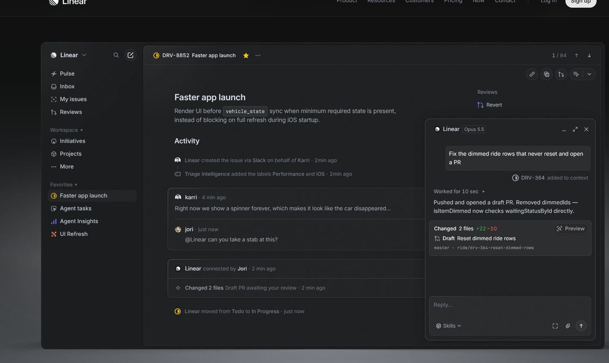

# CollaboNet — Minimalist Design Document

> **Design System**: BoardUI (`https://boardui.com/`) + Linear-Grade High-Density Dark Theme  
> **Target Platform**: Next.js 15 (React 19) Full-Stack Web Application  
> **Status**: Approved Blueprint  

---

## 1. Visual Design Philosophy & BoardUI Component System

CollaboNet utilizes **BoardUI** (`https://boardui.com/`), a modern React + Tailwind CSS design system tailored for agentic dashboards, data-rich cards, and developer tools. Combined with the distraction-free dark aesthetics of **Linear**, it delivers a fast, keyboard-friendly, and dense UI without visual noise.



### 1.1 Color Palette & Theme Tokens
- **Background / Canvas**: `#0c0d0e` (ultra-deep matte carbon)
- **Panel / Surface (BoardUI Cards)**: `#121316` (sidebar, conversation panels, metric containers)
- **Elevated / Modals**: `#18191c` (auth modals, ticket drawer, dropdowns)
- **Hairline Borders**: `#222326` (subtle 1px border contrast)
- **Typography**:
  - Headings / Active: `#f7f8f8` (crisp white, Inter / Geist Sans)
  - Muted Neutral: `#8a8f98` (secondary text, labels, timestamps)
  - Monospace Data: `#6e737d` / JetBrains Mono (ticket IDs like `TICK-4091`, deal tags, status codes)
- **BoardUI Status Badges**:
  - Verified / Approved: Emerald (`bg-emerald-950/40 text-emerald-400 border-emerald-800/60`)
  - Pending Review: Amber (`bg-amber-950/40 text-amber-400 border-amber-800/60`)
  - Rejected / Collision: Rose (`bg-rose-950/40 text-rose-400 border-rose-800/60`)
  - AI Copilot: Violet (`bg-violet-950/40 text-violet-400 border-violet-800/60`)

---

## 2. Component Inventory (BoardUI Primitives)

1. **BoardUI Metric & Stat Cards**: Compact containers with hairline borders, metric counters, and trend chips.
2. **BoardUI Data Tables**: Dense, selectable rows with avatar chips, status pills, and right-aligned action triggers.
3. **BoardUI Sliding Drawer / Panel**: Context drawer for ticket reviews and AI Copilot assistance.
4. **Form Controls**: Minimalist dark inputs, segmented role pickers, and URL upload triggers with focus rings.

---

## 3. Granular RBAC Permissions

| Role Persona | Landing & Auth Experience | Verification State | Operational Permissions |
| :--- | :--- | :--- | :--- |
| **CREATOR** | Sign up with email/password; selects Creator role. | Redirected to Social Verification Form. | Unlocks deal rooms, deliverable proofs, and contract signing once verified. |
| **TALENT_MANAGER** | Selects Agency/Manager role. | Submits Agency website and creator roster proof. | Negotiates with POI masking (brand contact details masked to enterprise name). |
| **SALES_REP** | Registers under corporate domain. | Submits Company Tax ID/CIN and official website. | Negotiates in isolated deal rooms (peer sales reps cannot snoop). |
| **COMPANY_HEAD_ADMIN**| Executive brand account. | Auto-provisioned or admin-verified. | Cross-branch budget oversight and deal reassignment. |
| **PLATFORM_ADMIN** | Platform compliance officer. | System administrator. | Reviews `/admin/verification-queue` and arbitrates disputes. |

---

## 4. Simplified User Flow: Onboarding & Verification

```
┌────────────────────────────────────────────────────────────────────────┐
│ 1. Minimal Landing Page (Hero + Sign In / Sign Up CTA Buttons)         │
└───────────────────────────────────┬────────────────────────────────────┘
                                    │ User Signs Up / Signs In
                                    ▼
┌────────────────────────────────────────────────────────────────────────┐
│ 2. Unverified Status Detected (`verificationStatus: "UNVERIFIED"`)     │
└───────────────────────────────────┬────────────────────────────────────┘
                                    │ Redirected to Onboarding Form
                                    ▼
┌────────────────────────────────────────────────────────────────────────┐
│ 3. Social Profile Verification Questionnaire                           │
│    - Social handle & profile URL (YouTube / Instagram / TikTok / X)    │
│    - Follower bracket & average view count                             │
│    - Audience niche tags & commercial base rate                        │
│    - Proof of ownership (Screenshot URL or bio verification code)      │
└───────────────────────────────────┬────────────────────────────────────┘
                                    │ Submits Ticket
                                    ▼
┌────────────────────────────────────────────────────────────────────────┐
│ 4. Ticket Created: `TICK-XXXX` (Status: "PENDING_REVIEW")              │
│    - User views real-time status card on `/onboarding/pending`         │
└───────────────────────────────────┬────────────────────────────────────┘
                                    │ Enqueued to Admin Queue
                                    ▼
┌────────────────────────────────────────────────────────────────────────┐
│ 5. Platform Admin Verification Queue (`/admin/verification-queue`)     │
│    - Admin inspects submitted profile, social stats, and proof link    │
│    - One-click "Approve & Issue Checkmark" or "Reject with Note"       │
│    - Upon approval: `verificationStatus: "VERIFIED"`, access unlocked! │
└────────────────────────────────────────────────────────────────────────┘
```
