# CollaboNet — Implementation Plan 1: Onboarding, Authentication & Verification Workflow

> **Target**: Next.js 15 (React 19) Web & React Native-Ready API  
> **Persistence**: MongoDB 7+ (Mongoose)  
> **UI Aesthetic**: Linear Dark Mode (`#0c0d0e`, `#121316`, hairline borders `#222326`)  
> **Status**: Ready for Implementation  

---

## 1. Scope & Objective

Build the complete first stage of CollaboNet:
1. **Landing Page with Auth**: Clean Linear-style landing page with Sign In / Sign Up modal.
2. **Initial Unverified State**: Every newly registered user starts in `UNVERIFIED` status and cannot access marketplace or messaging routes.
3. **Role-Tailored Verification Form**: Guides users through a questionnaire capturing social profile metrics, official business links, and proof of ownership.
4. **Admin Verification Ticket Queue**: Submitted requests generate a review ticket for the Platform Admin (`/admin/verification-queue`) for one-click approval or rejection.
5. **Multi-Platform API Readiness**: Clean RESTful JSON APIs (`/api/v1/*`) with Bearer token & cookie support so both Next.js Web and React Native mobile clients use the identical backend.

---

## 2. User Journey & State Flow

```mermaid
stateDiagram-v2
    [*] --> LandingPage: Visitor arrives
    LandingPage --> SignUp: Chooses Role (Creator, Manager, Brand Rep)
    SignUp --> UnverifiedAccount: Account created in MongoDB
    UnverifiedAccount --> VerificationForm: Redirected to Role-Specific Questionnaire
    VerificationForm --> TicketPending: Submits social stats & proof
    
    state AdminQueue {
        TicketPending --> AdminReview: Ticket routed to /admin/verification-queue
        AdminReview --> Approved: Admin clicks "Approve & Issue Badge"
        AdminReview --> Rejected: Admin clicks "Reject" (with reason)
    }
    
    Rejected --> VerificationForm: User can update proof & re-submit
    Approved --> MarketplaceUnlocked: Profile receives Verified Badge; Full access granted
    MarketplaceUnlocked --> [*]
```



---

## 3. Data Schema Specifications (MongoDB / Mongoose)

### 3.1 `User` Model
```typescript
interface IUser {
  _id: string;
  email: string;
  passwordHash: string;
  role: 'CREATOR' | 'TALENT_MANAGER' | 'SALES_REP' | 'COMPANY_HEAD_ADMIN' | 'PLATFORM_ADMIN';
  verificationStatus: 'UNVERIFIED' | 'PENDING_REVIEW' | 'VERIFIED' | 'REJECTED';
  rejectionReason?: string;
  orgId?: string;      // For Brand Reps & Head Admins
  branchId?: string;   // For Regional Branch Reps
  createdAt: Date;
  updatedAt: Date;
}
```

### 3.2 `VerificationTicket` Model
```typescript
interface IVerificationTicket {
  _id: string;
  ticketNumber: string; // e.g. "TICK-4091"
  userId: string;
  role: 'CREATOR' | 'TALENT_MANAGER' | 'SALES_REP';
  status: 'PENDING' | 'APPROVED' | 'REJECTED';
  
  // Questionnaire Data (Role-specific)
  formData: {
    // Creator fields
    primaryPlatform?: 'YOUTUBE' | 'INSTAGRAM' | 'TIKTOK' | 'X';
    handle?: string;
    profileUrl?: string;
    niche?: string[];            // e.g. ["Tech", "Gaming"]
    followerCount?: number;
    avgViews?: number;
    baseRate?: number;           // Standard commercial rate (USD)
    proofUrl?: string;           // Screenshot / video clip link
    
    // Talent Manager fields
    agencyName?: string;
    agencyWebsite?: string;
    rosterSize?: number;
    representationDocUrl?: string;
    
    // Brand Sponsor fields
    companyName?: string;
    officialWebsite?: string;
    workEmail?: string;
    registrationNumber?: string; // Tax ID / CIN
    campaignBudgetRange?: string;
  };

  adminNotes?: string;
  reviewedBy?: string;
  reviewedAt?: Date;
  createdAt: Date;
}
```

---

## 4. API Endpoints Contract (Web & Mobile Compatible)

All endpoints accept JSON payloads and support `Authorization: Bearer <token>` alongside `httpOnly` session cookies.

| Endpoint | Method | Role | Description |
| :--- | :--- | :--- | :--- |
| `/api/v1/auth/signup` | `POST` | Public | Registers a new user (`UNVERIFIED` by default). Returns JWT + user object. |
| `/api/v1/auth/login` | `POST` | Public | Authenticates credentials; returns user status & redirect destination. |
| `/api/v1/auth/me` | `GET` | Authenticated | Returns current authenticated user session, role, and verification status. |
| `/api/v1/verification/submit` | `POST` | `UNVERIFIED` | Submits the onboarding questionnaire and creates a `VerificationTicket`. |
| `/api/v1/verification/status` | `GET` | Authenticated | Checks active ticket status (`PENDING`, `APPROVED`, `REJECTED`). |
| `/api/v1/admin/verification-queue` | `GET` | `PLATFORM_ADMIN` | Returns paginated list of pending verification tickets. |
| `/api/v1/admin/verification/:id/decision` | `POST` | `PLATFORM_ADMIN` | Approves or rejects ticket; updates `User.verificationStatus`. |

---

## 5. UI / UX Design Specifications (Linear Aesthetic)

### 5.1 Landing Page (`/`)
- Minimalist hero with deep carbon background (`#0c0d0e`).
- High-contrast tagline: *"Trust & Transaction Infrastructure for Creators and Brands."*
- Clean auth modal (Sign In / Sign Up) with role picker pills:
  - `[Creator]` `[Talent Manager]` `[Brand Sponsor]`

### 5.2 Verification Onboarding Wizard (`/onboarding/verify`)
- Route-guarded: Unverified users attempting to access `/feed`, `/deals`, or `/messages` are automatically redirected here.
- Linear-style 2-step progress stepper:
  - **Step 1**: Basic Identity & Social Channel Selection.
  - **Step 2**: Metrics, Proof of Ownership & Commercial Rate.
- Field styling: `#121316` card surface, `#222326` borders, crisp white labels, monospace helper text.

### 5.3 Ticket Submitted Pending Screen (`/onboarding/pending`)
- Displays live status card:
  - Monospace ticket badge: `TICK-4091`
  - Status indicator: Amber pulsating dot `• PENDING ADMIN APPROVAL`
  - Reassurance banner: *"Our compliance team reviews tickets within 24 hours. Once verified, your checkmark and full marketplace access will activate."*

### 5.4 Platform Admin Review Queue (`/admin/verification-queue`)
- Accessible to `PLATFORM_ADMIN` (or toggleable via global Persona Switcher).
- Table layout inspired by Linear issues:
  - Columns: Ticket ID, Applicant Handle / Name, Role, Platform, Claimed Reach, Submitted Date, Actions.
  - Slide-over detail drawer: Displays full questionnaire answers, clickable social URLs, and proof media.
  - One-click buttons: `✓ Approve & Issue Checkmark` and `✕ Reject with Note`.

---

## 6. Implementation Task Breakdown

### Phase 1.1: Backend Foundation & MongoDB Models
- [ ] Setup MongoDB connection utility (`src/lib/mongodb.ts`) with connection caching for Next.js serverless functions.
- [ ] Define Mongoose schemas for `User` and `VerificationTicket` (`src/models/*`).
- [ ] Implement JWT utility (`src/lib/jwt.ts`) with password hashing (`bcryptjs`).

### Phase 1.2: Authentication & Verification API Routes
- [ ] Implement `/api/v1/auth/signup` and `/api/v1/auth/login`.
- [ ] Implement `/api/v1/auth/me` with session validation middleware.
- [ ] Implement `/api/v1/verification/submit` and `/api/v1/verification/status`.
- [ ] Implement `/api/v1/admin/verification-queue` and `/api/v1/admin/verification/[id]/decision`.

### Phase 1.3: Linear-Dark UI Components & Landing Page
- [ ] Build base UI primitives (`Button`, `Input`, `Select`, `Card`, `Badge`, `Modal`) in Tailwind dark theme.
- [ ] Build Landing Page with Hero and Auth Modal (`/`).
- [ ] Add Global Header with Active Role / Persona Badge and Logout.

### Phase 1.4: Onboarding Questionnaire Wizard
- [ ] Build `/onboarding/verify` with role-adaptive form fields (Creator stats vs. Manager roster vs. Brand domain).
- [ ] Build `/onboarding/pending` ticket status card with live polling/refresh.

### Phase 1.5: Platform Admin Verification Queue UI
- [ ] Build `/admin/verification-queue` with Linear-style table, filter tabs (All, Pending, Approved, Rejected).
- [ ] Slide-over ticket review drawer with one-click decision actions.

### Phase 1.6: Route Guards & End-to-End Verification
- [ ] Implement Next.js middleware / client auth guard redirecting unverified users to `/onboarding/verify`.
- [ ] Write end-to-end test script (`scripts/verify-onboarding.ts`) validating complete flow:
  $$\text{Sign Up} \to \text{Submit Verification} \to \text{Admin Approves} \to \text{Marketplace Unlocked}$$
