# CollaboNet — High-Level Design (HLD) of Services

> **System**: CollaboNet Trust & Management Platform  
> **Document Purpose**: High-Level Service Architecture, Inter-Service Communication, and Boundaries  
> **Status**: Approved Specification  

---

## 1. System Architecture Diagram

```mermaid
flowchart TB
    subgraph ClientLayer["1. Client Layer (Linear-Inspired UI)"]
        WebPortal["Next.js 15 App (React 19, Turbopack, Tailwind Dark)\n- Sleek Left Nav: Feed, Deals, Radar, Calendar, Hall of Shame\n- Central Deal & Negotiation Canvas\n- Slide-over AI Copilot Assistant"]
    end

    subgraph APILayer["2. API Gateway & Middleware"]
        APIGateway["Next.js Route Handlers (/api/v1/*)\n- JWT Session & Role Scoping\n- Enterprise Branch Fencing Middleware\n- Manager POI Privacy Filter"]
    end

    subgraph ServiceLayer["3. Domain Services"]
        AuthSvc["Auth & Identity Service\n(RBAC, Multi-Branch Membership)"]
        VerifySvc["Two-Phase Verification Service\n(Webcam Nonce + HITL Admin Queue)"]
        MarketSvc["Discovery & Marketplace Service\n(Structured Filters + NL Semantic Search)"]
        ChatSvc["Isolated Deal Room Service\n(Realtime Messaging & Peer Rep Isolation)"]
        AISvc["AI Copilot & Intelligence Engine\n(Thread Summarizer, Contract Extractor, Collision Radar)"]
        ContractSvc["Contract & Escrow Service\n(PDF Generation, SHA-256 Hashing, E-Sign)"]
        DeliverableSvc["Deliverables & Calendar Service\n(Milestone Workflow & Proof Submission)"]
        ShameSvc["Reputation & Hall of Shame Service\n(Dispute Arbitration & Public Ledger)"]
    end

    subgraph PersistenceLayer["4. Data & Persistence (MongoDB)"]
        MongoDB[("MongoDB Database\n- users & profiles\n- organizations & branches\n- campaigns & deliverables\n- conversations & messages\n- contracts & audit logs\n- disputes & hall_of_shame")]
        BlobStore[("Object / Asset Storage\n- Verification Videos & Nonce Audio\n- Executed Contract PDFs\n- Proof Submissions")]
    end

    ClientLayer --> APILayer
    APILayer --> ServiceLayer
    ServiceLayer --> PersistenceLayer
```



---

## 2. Core Domain Services Breakdown

### 2.1 Identity, Authentication & RBAC Service (`AuthSvc`)
- **Responsibilities**: User registration, session lifecycle, role assignment, and enterprise organization mapping.
- **Roles**:
  - `CREATOR`: Solo content creator managing media kit and deals.
  - `TALENT_MANAGER`: Agency managing multiple creator rosters with masked POI views.
  - `SALES_REP`: Brand representative managing dedicated sponsor campaigns within a branch.
  - `COMPANY_HEAD_ADMIN`: Corporate executive overseeing cross-branch spend, members, and deals.
  - `PLATFORM_ADMIN`: Compliance officer reviewing verifications and disputes.
- **MongoDB Collection**: `users`, `organizations`.

---

### 2.2 Two-Phase Trust & Verification Service (`VerifySvc`)
- **Responsibilities**: Eliminates mediator scams and ghost creators before marketplace access.
- **Workflow**:
  - **Phase 1 (Automated Nonce Check)**: Issues dynamic 6-word session nonce; records 10-second browser webcam video; Whisper ASR validates spoken audio match.
  - **Phase 2 (HITL Admin Queue)**: Submissions routed to `/admin/verification-queue` for auditor review and checkmark badge issuance.
- **MongoDB Collection**: `verification_requests`.

---

### 2.3 Discovery & Marketplace Service (`MarketSvc`)
- **Responsibilities**: Creator directory, public campaign listings, and smart search.
- **Search Modes**:
  1. *Structured Search*: By platform (YouTube, Instagram, TikTok), niche, budget tiers, and follower count.
  2. *Natural Language Search*: LLM query parser translates freeform queries (*"Find tech YouTubers in India under $2,000"*) into filter criteria and relevance-ranked results.
- **MongoDB Collection**: `campaigns`, `creator_profiles`.

---

### 2.4 Isolated Deal Room & Messaging Service (`ChatSvc`)
- **Responsibilities**: Secure real-time negotiation channels.
- **Enterprise Fencing**:
  - Peer reps within the same organization cannot access or view each other's deals.
  - Talent Managers view company-level metadata (e.g., *"Nike Global"*), masking internal employee PII.
  - Scam Guard: Regex interceptor flags off-platform payment solicitations.
- **MongoDB Collection**: `conversations`, `messages`.

---

### 2.5 AI Copilot & Deal Intelligence Engine (`AISvc`)
- **Responsibilities**:
  - **✨ In-Chat Summarizer**: Synthesizes deal threads into 3-bullet negotiation briefs.
  - **✨ Chat-to-Contract Extractor**: Extracts deliverables, dates, and payout amounts from chat directly into a populated contract schema.
  - **Zero-Knowledge Collision Radar**: Warns reps if another internal branch is negotiating with the same creator without revealing transcripts or budgets.
- **Inputs/Outputs**: Sanitized message streams $\to$ Validated JSON DTOs.

---

### 2.6 Contract & Escrow Ledger Service (`ContractSvc`)
- **Responsibilities**:
  - PDF contract generation (`pdf-lib`).
  - Cryptographic SHA-256 document hashing stored immutably on the deal document.
  - Dual e-signature capture (Canvas drawing/typed signature + IP + UTC timestamp).
  - Escrow milestone lock before production begins.
- **MongoDB Collection**: `contracts`.

---

### 2.7 Deliverables & Calendar Service (`DeliverableSvc`)
- **Responsibilities**:
  - Tracks 3-stage milestone lifecycle:
    $$\text{Script / Outline} \longrightarrow \text{Rough Cut Preview} \longrightarrow \text{Live Post URL Verification}$$
  - Unlocks escrow release upon final milestone verification.
  - Calendar agenda for content drops and brand walk-in events.
- **MongoDB Collection**: `deliverables` (embedded inside `contracts` / `campaigns`).

---

### 2.8 Reputation & "Hall of Shame" Service (`ShameSvc`)
- **Responsibilities**:
  - Evidentiary dispute submission (unpaid balances, ghosting, unauthorized middleman skimming).
  - 72-hour admin arbitration workflow.
  - Public `/hall-of-shame` registry indexing confirmed fraudsters with redacted evidence.
- **MongoDB Collection**: `disputes`, `hall_of_shame`.

---

## 3. MongoDB Data Collections Architecture

```
collabonet_db/
├── users               (id, email, role, orgId, branchId, isVerified)
├── creator_profiles    (userId, handle, platform, niche, stats, baseRate)
├── organizations       (id, name, headAdminId, branches: [{ id, name, budget }])
├── campaigns           (id, orgId, branchId, title, budget, niche, status)
├── conversations       (id, campaignId, repId, creatorId, managerId, status)
├── messages            (id, conversationId, senderId, content, createdAt)
├── contracts           (id, conversationId, terms, pdfUrl, sha256Hash, signatures, status)
└── disputes            (id, reporterId, offenderId, evidenceUrls, status, published)
```
